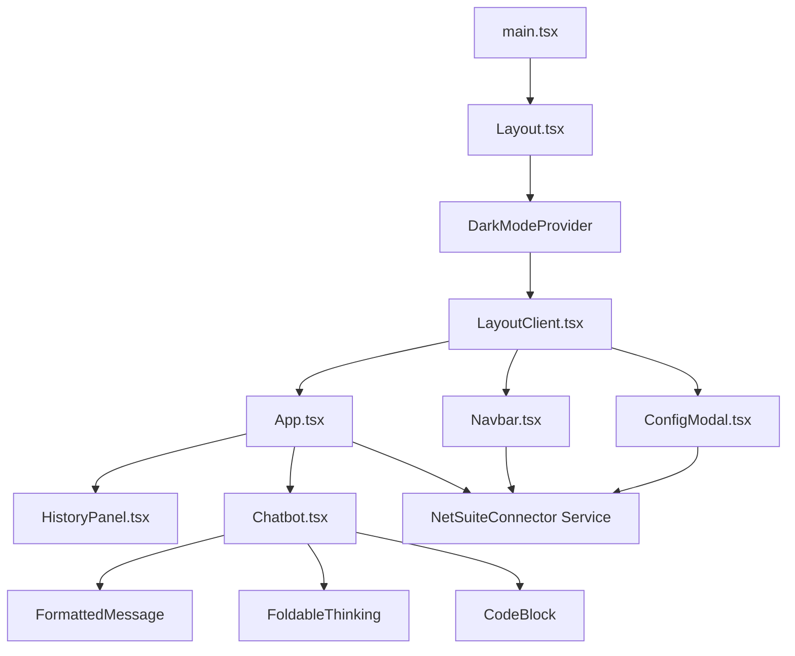
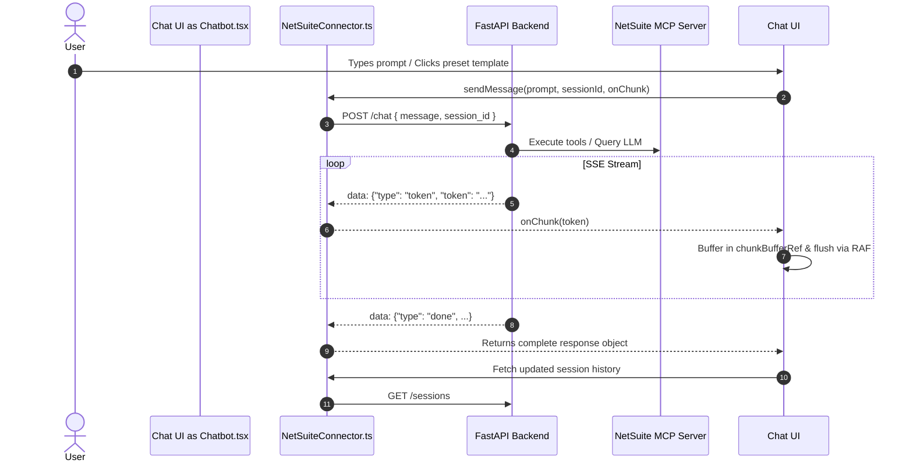

# Suite Forge MCP Client — UI Design & Architecture Documentation

## Executive Overview

**Suite Forge MCP** is an enterprise-grade AI assistant interface for NetSuite ERP systems powered by the **Model Context Protocol (MCP)**. The front-end client is built with React 19, TypeScript, Vite, and Tailwind CSS. It provides a sleek, modern, dark-themed workspace where users can interact with LLM models (Gemini, Claude, OpenAI, Ollama, etc.), execute SuiteQL queries, generate SuiteScript 2.1 code, inspect record schemas, switch NetSuite accounts, and view live thought processes via collapsible reasoning drawers.

---

## Technical Stack & Dependencies

| Layer | Technology | Purpose |
| :--- | :--- | :--- |
| **Framework & Core** | React 19, TypeScript (~5.9.3) | Component architecture, strict type safety, UI state rendering |
| **Build System & HMR** | Vite 7 (`@vitejs/plugin-react`) | Fast developer builds, ESM modules, sub-second HMR |
| **Styling & Theme** | Tailwind CSS v3.4, PostCSS, Custom CSS | Utility-first styling, glassmorphism UI, custom dark theme |
| **Typography** | Geist Sans & Geist Mono | High-legibility sans font for UI, precision monospace for code/IDs |
| **Iconography** | React Icons (`react-icons/fi`) | Feather iconography for consistent enterprise visual language |
| **Markdown Processing** | `react-markdown` v10, `remark-gfm` | GitHub-flavored markdown, custom code blocks, tables, lists |
| **API & Streaming** | Fetch API with `ReadableStream` | Real-time Server-Sent Events (SSE) token streaming |
| **State Persistence** | React Context API, `localStorage`, CustomEvents | Decoupled cross-component events and theme persistence |

---

## UI/UX Design System & Aesthetics

### 1. Color Palette & Dark Theme Philosophy
The UI defaults to a sleek, dark-mode aesthetic engineered to reduce eye strain during extended development and database querying tasks:
- **Base Background**: Deep slate blue (`#090d16` / `bg-slate-900`).
- **Brand Primary Accent**: Vibrant Indigo gradient (`from-indigo-600 via-indigo-500 to-cyan-400`).
- **Status Indicators**:
  - **Connected / Success**: Emerald Green (`#10b981`) with pulsing outer ring animation.
  - **Configured / Processing**: Electric Cyan (`#06b6d4`) / Indigo (`#6366f1`).
  - **Warning / Disconnected**: Warm Amber (`#f59e0b`).
  - **Error / Clear Action**: Rose (`#f43f5e`).

### 2. Glassmorphism & Micro-Animations
- **Translucent Panels**: Navigation bars, drawers, and input containers feature `backdrop-blur-xl` combined with semi-transparent background fills (`bg-slate-900/80`, `bg-white/70`).
- **Ambient Lighting**: Ambient radial background blurs (`bg-indigo-600/10`, `bg-cyan-600/10`, `bg-purple-600/10`) positioned behind the viewport creating soft depth layers.
- **Interactive Feedback**: Active micro-scale button effects (`active:scale-95`), hover state transition fills, spinning indicators on refresh/thinking, and smooth entrance transitions (`animate-slide-up`, `animate-fade-in`).

### 3. Typography & Monospace Precision
- **Geist Sans**: Main interface font loaded dynamically via CDN in [`index.html`](file:///D:/Code/suite-forge-mcp/client/index.html).
- **Geist Mono**: Used for all code blocks, NetSuite field names, account IDs, JSON payloads, and timestamps.

---

## Component Architecture Overview



---

## Component Breakdown & Technical Specifications

### 1. `Layout.tsx` & `LayoutClient.tsx`
- **Location**: [`src/Layout.tsx`](file:///D:/Code/suite-forge-mcp/client/src/Layout.tsx) & [`src/components/LayoutClient.tsx`](file:///D:/Code/suite-forge-mcp/client/src/components/LayoutClient.tsx)
- **Role**: Top-level shell provider.
- **Key Responsibilities**:
  - Context Provider Wrapper (`DarkModeProvider`).
  - Renders ambient radial lighting effects when `isDarkMode` is true.
  - Houses the top [`Navbar`](file:///D:/Code/suite-forge-mcp/client/src/components/Navbar.tsx) and main viewport.
  - Controls opening and closing of [`ConfigModal`](file:///D:/Code/suite-forge-mcp/client/src/components/ConfigModal.tsx) via modal state.
  - Receives `onConfigSaved` events to trigger navbar status refreshes (`refreshTrigger`).

### 2. `App.tsx`
- **Location**: [`src/App.tsx`](file:///D:/Code/suite-forge-mcp/client/src/App.tsx)
- **Role**: Main Application Orchestrator.
- **State Management**:
  - `activeSessionId`: Controls currently active chat session (defaults to `'default'`).
  - `messages`: Active conversation message array `[{ text, sender: 'user' | 'bot' }]`.
  - `savedSessions`: List of chat sessions loaded from backend SQLite database.
  - `showHistory`: Boolean toggling drawer visibility.
- **Key Workflows**:
  - **Account & Session Loading**: Loads configuration via `connector.getConfig()`, fetches saved sessions for the active NetSuite account ID, and loads stored session messages.
  - **Event Synchronization**: Listens to custom window event `suite_forge_config_updated` to re-fetch accounts and session messages upon account or model changes.
  - **Message Streaming Handler**: Invokes `connector.sendMessage(message, activeSessionId, onChunk)` and updates state incrementally.

### 3. `Navbar.tsx`
- **Location**: [`src/components/Navbar.tsx`](file:///D:/Code/suite-forge-mcp/client/src/components/Navbar.tsx)
- **Role**: Header Navigation, System Status & Account Selector.
- **Features**:
  - **Brand Banner**: Title with pulsing MCP AI badge.
  - **NetSuite Status Badge**: Displays connected Account ID or 'Disconnected' with animated status LED.
  - **AI Model Badge**: Displays active model name (e.g. `gemini-1.5-pro`, `gpt-4o`) or 'Not Configured'.
  - **Account Dropdown Selector**:
    - Queries backend `/accounts` list.
    - Switch active account dynamically via `/accounts/select`.
    - Delete stored accounts via `/accounts/{id}`.
    - Quick link to open modal for adding new accounts.
  - **Theme Toggle**: Switch between Dark and Light mode.
  - **Manual Status Refresh**: Trigger status re-fetch with spin animation.

### 4. `Chatbot.tsx`
- **Location**: [`src/components/Chatbot.tsx`](file:///D:/Code/suite-forge-mcp/client/src/components/Chatbot.tsx)
- **Role**: Interactive Chat Workspace & Rich Markdown Renderer.
- **Features & Sub-components**:
  - **Empty State Hero Grid**: Displays 4 interactive feature cards for quick prompt execution:
    1. *Run SuiteQL Statement*
    2. *Generate SuiteScript 2.1*
    3. *Sales Order Inspection*
    4. *NetSuite Record Schema*
  - **Thinking Process Engine (`parseThinkingAndResponse`)**:
    - Parses standard `<think>...</think>` XML tags.
    - Parses stringified dictionary/payload thinking formats (`{'type': 'thinking', ...}`).
    - Isolates raw MCP tool payloads (`Tool Payload: {"method": ...}`).
    - Extracts final user-facing text response separate from reasoning logs.
  - **`FoldableThinking`**: Collapsible UI container showing real-time AI reasoning steps with pulsing status LEDs and spinner animations.
  - **`FormattedMessage`**: Markdown component leveraging `react-markdown` and `remark-gfm`. Renders customized GitHub tables, headings, blockquotes, lists, links, and inline code pills.
  - **`CodeBlock`**: Custom code block container featuring language badge, monospace font, code box scrollbars, and one-click "Copy Code" button with copy confirmation feedback.
  - **Attachment Snippet Menu**: Floating dropdown allowing instant insertion of common NetSuite code snippets (SuiteQL, RESTlet template, Sales Order search).
  - **Streaming Performance Optimization**: Uses `requestAnimationFrame` and a chunk buffer (`chunkBufferRef`) to batch incoming token streams, preventing UI lag and excessive React state re-renders during high-frequency token streams.

### 5. `HistoryPanel.tsx`
- **Location**: [`src/components/HistoryPanel.tsx`](file:///D:/Code/suite-forge-mcp/client/src/components/HistoryPanel.tsx)
- **Role**: Collapsible Left Drawer Sidebar.
- **Features**:
  - **New Conversation Button**: Spawns a new session with unique timestamp ID (`session_${Date.now()}`).
  - **Unified Search Input**: Filters preset templates and chat session titles in real time.
  - **NetSuite Copilot Templates**: Quick preset shortcuts organized by category (`SuiteQL`, `RESTlet`, `SalesOrder`, `Schema`, `UserEvent`).
  - **Recent History List**: Displays SQLite-backed session items with active highlight state and clear history button.
  - **System Info Footer**: Displays database connection state and version tag.

### 6. `ConfigModal.tsx`
- **Location**: [`src/components/ConfigModal.tsx`](file:///D:/Code/suite-forge-mcp/client/src/components/ConfigModal.tsx)
- **Role**: System Configuration & Credentials Modal.
- **Tabs**:
  1. **NetSuite ERP**: Form for NetSuite Account ID and Client ID. Initiates OAuth 2.0 PKCE flow in a pop-up window (`window.open`) and listens for `NETSUITE_AUTH_SUCCESS` window messages.
  2. **AI Provider**: Configure API Provider (Gemini, Anthropic/Claude, OpenAI, Ollama, etc.), enter API keys with visibility toggle, fetch available models (`fetchModels`), and activate selected model (`useModel`).
  3. **MCP Tools**: Explorer listing all available NetSuite MCP tools fetched from `/get-tools-list`. Features search filtering, expandable tool descriptions, argument schemas, and copyable tool names.

### 7. `NetSuiteConnector.tsx` Service
- **Location**: [`src/components/NetSuiteConnector.tsx`](file:///D:/Code/suite-forge-mcp/client/src/components/NetSuiteConnector.tsx)
- **Role**: Singleton HTTP & SSE API Client Service.
- **API Mapping**:

| Method | Endpoint | Description |
| :--- | :--- | :--- |
| `sendMessage()` | `POST /chat` | Sends user prompt, handles SSE streaming via `ReadableStream` |
| `authenticateNetSuite()` | `POST /auth` | Triggers NetSuite OAuth authorization URL generation |
| `getAccounts()` | `GET /accounts` | Fetches configured NetSuite accounts and active account |
| `selectAccount()` | `POST /accounts/select` | Switches active NetSuite account |
| `deleteAccount()` | `DELETE /accounts/{id}` | Removes NetSuite account credentials |
| `getSessions()` | `GET /sessions` | Fetches saved chat sessions from SQLite database |
| `getMessages()` | `GET /messages` | Retrieves stored messages for a specific session |
| `clearMessages()` | `DELETE /messages` | Clears chat message history |
| `fetchModels()` | `POST /models` | Fetches available models for selected provider |
| `useModel()` | `POST /use-model` | Sets active AI model and API credentials on backend |
| `getConfig()` | `GET /get-config` | Fetches active system configuration status |
| `getToolsList()` | `GET /get-tools-list` | Fetches registered MCP tools and JSON schemas |

### 8. `DarkModeContext.tsx`
- **Location**: [`src/contexts/DarkModeContext.tsx`](file:///D:/Code/suite-forge-mcp/client/src/contexts/DarkModeContext.tsx)
- **Role**: Theme State Provider.
- **Key Mechanics**: Stores preference in `localStorage` (`suite_forge_theme`), defaults to `dark`, and dynamically updates class lists on `document.documentElement`.

---

## Data Flow & Event Architecture



---

## File Structure Reference

```
client/
├── public/
│   └── file.svg
├── src/
│   ├── assets/
│   ├── components/
│   │   ├── Chatbot.module.css
│   │   ├── Chatbot.tsx               # Main workspace, streaming chat & markdown
│   │   ├── ConfigModal.module.css
│   │   ├── ConfigModal.tsx           # NetSuite, AI Provider & MCP Tools modal
│   │   ├── HistoryPanel.module.css
│   │   ├── HistoryPanel.tsx          # Drawer history & template library
│   │   ├── LayoutClient.tsx          # Viewport shell & ambient lighting
│   │   ├── Navbar.module.css
│   │   ├── Navbar.tsx                # Status header & multi-account switcher
│   │   └── NetSuiteConnector.tsx     # API client singleton & SSE stream reader
│   ├── contexts/
│   │   └── DarkModeContext.tsx       # Dark/Light theme context provider
│   ├── App.css                       # Fallback styling
│   ├── App.tsx                       # Master application container
│   ├── index.css                     # Tailwind directives, custom scrollbars & glassmorphism
│   ├── Layout.tsx                    # Root layout provider wrapper
│   └── main.tsx                      # Entry point mounting root component
├── index.html                        # HTML shell loading Geist fonts
├── package.json                      # Project dependencies and npm scripts
├── postcss.config.mjs                # PostCSS configuration
├── tailwind.config.js                # Tailwind theme customization & color tokens
├── tsconfig.json                     # TypeScript parent configuration
├── tsconfig.app.json                 # React app TypeScript configuration
├── tsconfig.node.json                # Vite Node TypeScript configuration
└── vite.config.ts                    # Vite build settings & React plugin setup
```

---

## Recommended Architectural & UI Improvements

### 1. State Management & Data Fetching (TanStack Query / Zustand)
- **Current Limitation**: Custom state synchronizations use manual `window.addEventListener('suite_forge_config_updated')`, prop-drilling, and manual `useEffect` refetch logic across `App.tsx`, `Navbar.tsx`, and `ConfigModal.tsx`.
- **Proposed Solution**:
  - Integrate **TanStack Query (React Query)** or **Zustand** for state management and server-state caching.
  - Caching account lists (`/accounts`), model options (`/models`), and active session message streams with automatic background revalidation and query invalidation.
  - Eliminates custom event listeners and prevents unnecessary re-renders.

### 2. Full AST Syntax Highlighting for Code Blocks (Shiki / Prism Integration)
- **Current Limitation**: The `CodeBlock` component currently relies on basic un-highlighted monospace text wrapped in pre/code elements.
- **Proposed Solution**:
  - Integrate **Shiki** or **Prism.js** (via `react-syntax-highlighter` or `rehype-highlight`).
  - Provide full syntax highlighting for JavaScript/TypeScript (SuiteScript 2.1) and SQL (SuiteQL queries).
  - Add a **"Download File"** action button alongside the "Copy Code" button to allow instant downloading of generated `.js` or `.sql` files directly from chat bubbles.

### 3. List Virtualization for Long Conversations & MCP Tool Lists
- **Current Limitation**: Rendering 100+ message bubbles or dozens of MCP tool schemas simultaneously creates hundreds of DOM nodes, causing potential frame drops during continuous SSE token streams.
- **Proposed Solution**:
  - Implement list virtualization using `@tanstack/react-virtual` or `react-window` in [`Chatbot.tsx`](file:///D:/Code/suite-forge-mcp/client/src/components/Chatbot.tsx) and [`ConfigModal.tsx`](file:///D:/Code/suite-forge-mcp/client/src/components/ConfigModal.tsx).
  - Only render visible message DOM nodes in the viewport.

### 4. Code Splitting & Dynamic Imports
- **Current Limitation**: Large modal and markdown renderer components are bundled directly into the main entry bundle.
- **Proposed Solution**:
  - Wrap `ConfigModal` and heavy markdown plugins with `React.lazy()` and `<Suspense>`.
  - Reduces initial JavaScript bundle size, improving initial page load time and time-to-interactive (TTI).

### 5. Accessibility (a11y) & Keyboard Navigation Shortcuts
- **Current Limitation**: Dialogs and dropdown menus lack explicit ARIA roles (`role="dialog"`, `aria-expanded`, `aria-live="polite"` for streaming tokens), focus traps, and global hotkeys.
- **Proposed Solution**:
  - Add WAI-ARIA compliant attributes to modals and dropdown menus.
  - Add Focus Trapping inside `ConfigModal` to ensure keyboard users cannot tab outside open dialogs.
  - Introduce global keyboard shortcuts:
    - `Ctrl / Cmd + K`: Focus global search in History Drawer.
    - `Ctrl / Cmd + Shift + N`: Create new conversation.
    - `Esc`: Close open drawers and modals.
  - Add `aria-live="polite"` regions so screen readers announce incoming streaming bot tokens.

### 6. Error Boundary & Resilience Shielding
- **Current Limitation**: Render errors inside complex markdown tables or unexpected JSON streaming chunks could potentially crash the React component tree.
- **Proposed Solution**:
  - Implement React Error Boundaries (`react-error-boundary`) wrapping `FormattedMessage` and `Chatbot`.
  - Isolate rendering crashes to specific message bubbles without breaking the application navigation or losing user input state.

### 7. Conversation Export & Session Management
- **Current Limitation**: Sessions can only be viewed or cleared, with no options to export or back up chat transcripts.
- **Proposed Solution**:
  - Add an **Export Chat** feature allowing users to export active conversations as Markdown (`.md`), JSON, or HTML/PDF reports.
  - Add session tagging (e.g. `[SuiteQL]`, `[SuiteScript]`, `[Bugfix]`) to categorize recent history items.

### 8. CSS Module Consolidation
- **Current Limitation**: The codebase contains several unused or partially populated `.module.css` files (`Chatbot.module.css`, `ConfigModal.module.css`, `HistoryPanel.module.css`, `Navbar.module.css`) alongside inline Tailwind utility classes.
- **Proposed Solution**:
  - Consolidate all custom styles into Tailwind CSS utilities and theme design tokens inside [`tailwind.config.js`](file:///D:/Code/suite-forge-mcp/client/tailwind.config.js) and [`index.css`](file:///D:/Code/suite-forge-mcp/client/src/index.css), removing legacy `.module.css` files to simplify developer maintenance.

### 9. Comprehensive Testing Suite (Vitest & Playwright)
- **Current Limitation**: No automated unit or end-to-end (E2E) testing framework is configured in the client directory.
- **Proposed Solution**:
  - Set up **Vitest** and **React Testing Library** for testing parsing utilities (`parseThinkingAndResponse`), connector services, and component rendering.
  - Set up **Playwright** for E2E integration testing covering OAuth popup authorization flows, account selection, and chat message streaming.

---

## Design Principles Summary

1. **Enterprise First**: Purpose-built for SuiteQL, SuiteScript, and NetSuite record schema visualization.
2. **Zero-Lag Streaming**: Token buffering via `requestAnimationFrame` ensures high FPS UI during LLM token streams.
3. **Decoupled Event Model**: Cross-component communication uses lightweight custom window events (`suite_forge_config_updated`) and React Context.
4. **Transparent AI Reasoning**: Thought processes (`<think>` tags and tool invocation payloads) are clearly separated into collapsible drawers.
5. **Fluid Dark Theme**: Modern glassmorphism panels, soft ambient radial lighting, and curated slate/indigo color tokens.
